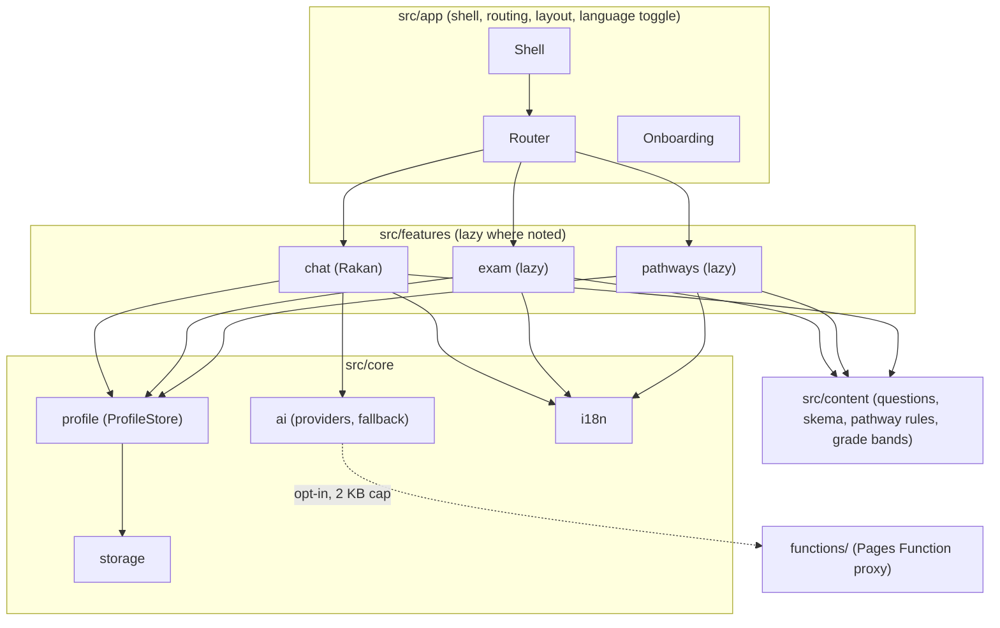
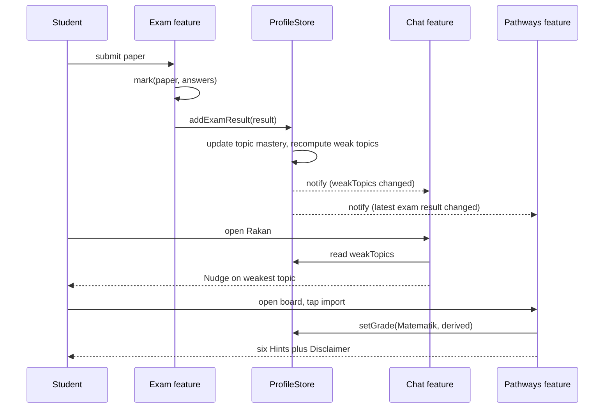
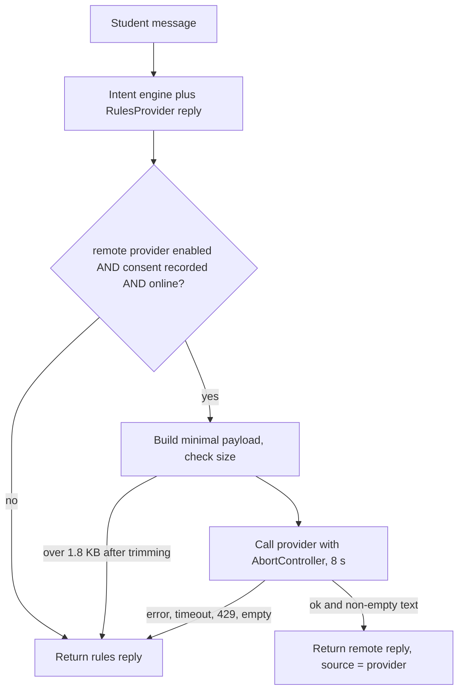

# Design Document

## Overview

Rakan Ulangkaji is a static, offline-first single page app (Vite, React, TypeScript strict) for Malaysian SPM students. It stitches three modes into one product: Rakan chat, Exam Mode, and Pathway Board. All three read and write one shared Student Profile and Progress Record through `core/profile`. That shared state is the point of the project.

Scope is sized for one developer over about 10 evenings: one subject (Matematik), one original Paper, six simplified pathways, and a deterministic rules engine for chat. Remote AI is optional and never decides marks or eligibility.

### Design goals

- Everything in the demo path runs with no network and no key (Requirements 4.13, 15.11, 20.3).
- Marking, timer, weak-topic, and eligibility logic are pure functions, so they are easy to test and to property-test.
- Features never import each other. They import from `core` and read shared data through the profile (Requirement 2.1).
- Small initial bundle (200 KB gzipped, Requirement 15.10). Exam and pathway content load lazily.
- Public copy, UI strings, and this design contain no em dashes (Requirements 14.11, 17).

### Key decisions

| Decision | Choice | Rationale |
|---|---|---|
| State sharing | `ProfileStore` in `core/profile` with subscribe API | Satisfies "no cross-feature imports" and the 100 ms notify targets (2.2, 2.3) |
| State library | Plain React context plus `useSyncExternalStore`, no Redux or Zustand | Fewer dependencies, smaller bundle |
| Routing | Hash router written in about 40 lines, or `react-router` if bundle allows | Static hosting with no rewrite rules; offline friendly |
| Storage | IndexedDB via a tiny hand-written wrapper, localStorage fallback | Matches tech.md; no `idb` dependency needed for a few keys |
| Timer | Timestamp based (`startedAt` plus duration) | Correct after tab sleep (9.8, 9.15) |
| Marking | Normalise then exact match against `accepted` per point | Deterministic, explainable (10.2 to 10.4) |
| Eligibility | Declarative rule data plus one evaluator | Rules are data with `lastReviewed` and source (12.6) |
| AI | One interface, three providers, silent fallback to rules | Requirement 4 and 5 |
| PWA | Hand-written service worker, precache plus runtime cache for lazy chunks | No Workbox, to save bundle and complexity |
| Property tests | `fast-check` as a dev dependency | Free, open source, runs in Vitest with no network |

### Research notes

- Cloudflare Pages Functions live in a top-level `functions/` directory and are served on the same origin. Workers AI is called through an `AI` binding configured in the Pages project settings, so no key is stored in the repo. The free tier has a daily neuron allowance, so rate-limit responses must be expected and handled by fallback (4.10).
- The Web Crypto and `performance.now` APIs are not needed. `Date.now()` with a stored start timestamp is sufficient for the exam timer and is injectable for tests.
- Service worker updates: a newly installed worker stays in the `waiting` state until all clients close unless `skipWaiting()` is called. Not calling `skipWaiting()` gives "activate on next launch" (15.8) and prevents mid-exam replacement (15.9) with no extra code. An in-exam guard is still added for safety (see PWA section).
- Content was reviewed against the steering docs only. No past-paper material is used for questions.

## Architecture

### Layers



Rules:

1. A feature may import from `core`, `content`, and shared `styles`. It must not import from another feature. An ESLint `no-restricted-imports` rule enforces this (2.1).
2. Cross-feature data flows only through `ProfileStore` values: `Student_Profile`, `Progress_Record`, `Grade_Set`, chat history, and in-progress exam state.
3. Navigation between features (chips, "open board" button) goes through a `navigate(route)` function supplied by the Shell via context, not through a feature import (3.10, 10.10).
4. Pure logic (marker, timer, eligibility, weak topics, intent engine) sits in plain `.ts` files with no React imports, next to the feature that owns it, so tests need no DOM.

### Folder layout

```
src/
  app/            Shell, Router, Onboarding, LanguageToggle, OfflineNotice, Settings
  features/
    chat/         ChatScreen, intents.ts, replies.ts, quiz.ts, nudge.ts
    exam/         ExamScreen, timer.ts, marker.ts, grade.ts, runner state
    pathways/     BoardScreen, eligibility.ts, GradeForm, PathwayCard
  core/
    profile/      ProfileStore.ts, weakTopics.ts, types.ts
    storage/      StorageService.ts, idb.ts, localStore.ts, migrations.ts, exportImport.ts
    ai/           types.ts, generateReply.ts, rulesProvider.ts, userKeyProvider.ts, proxyProvider.ts
    i18n/         strings.bm.ts, strings.en.ts, I18nProvider.tsx, t.ts
  content/        matematik.paper.ts, pathwayRules.ts, gradeBands.ts, topicExplanations.ts
  styles/         tokens.css, base.css, stitch.css, chat.css, exam.css, board.css
functions/
  api/chat.ts     Pages Function proxy
public/           manifest.webmanifest, icons, sw.js
docs/             README support, demo-script.md
```

`core/profile/types.ts` holds the shared types so that both `core` and features can import them without a cycle.

### Runtime flow for the "Frankenstein" loop



## Components and Interfaces

### Shell and routing (`src/app`)

Routes (hash based, so static hosting needs no rewrites):

| Route | Screen | Loaded |
|---|---|---|
| `#/welcome` | Onboarding (max 4 steps, 1.7) | eager |
| `#/` | Home with caption naming the three modes and the shared profile (17.11) | eager |
| `#/rakan` | Rakan chat | eager |
| `#/exam` | Exam instructions, runner, results | lazy chunk plus lazy paper data |
| `#/board` | Pathway Board | lazy chunk plus lazy rules data |
| `#/settings` | Language, remote AI, API key, export, import, delete, demo toggle | eager |

Behaviour:

- Route guard: if `ProfileStore.profile === null`, every route except `#/welcome` redirects to `#/welcome` (1.1).
- `LanguageToggle` is rendered by the Shell header on every screen including onboarding, with a 44 px target (14.1). It calls `profileStore.setLanguage(lang)` or, before a profile exists, `i18n.setLanguage(lang)` and a pre-profile preference key.
- `document.documentElement.lang` is set from the language on first load and on every change (`bm` maps to `ms`, `en` maps to `en`) (16.11, 16.12).
- Bottom navigation bar with three links, current mode marked with `aria-current="page"` (17.5).
- Mode transition: a CSS-only stitched-seam wipe of 300 ms, disabled under `prefers-reduced-motion` (17.6, 17.7). Navigation is not delayed by the animation.
- `OfflineNotice` listens to `online` and `offline` events (15.6).
- Lazy routes use `React.lazy`. If the dynamic import rejects while offline, the Shell shows the "needs one online visit first" message with a link back to Rakan (15.5).
- `StorageStatusBanner` shows the kind messages for storage failures (2.8, 2.9, 3.13, 9.13).

### ProfileStore (`src/core/profile`)

```ts
export interface ProfileStore {
  getState(): ProfileState;
  subscribe(listener: () => void): () => void;       // useSyncExternalStore compatible

  saveProfile(input: ProfileInput): Result<StudentProfile, ValidationError[]>;
  setLanguage(lang: Language): void;

  appendChat(msg: ChatMessage): void;                // keeps latest 200 (3.12)
  recordQuizAttempt(a: QuizAttempt): void;           // 2.4
  addExamResult(r: ExamResult): void;                // 2.2
  saveExamInProgress(s: ExamInProgress | null): void;

  setGrade(subject: SpmSubject, grade: Grade): void; // 11.7
  importMathGradeFromLatestExam(): ImportOutcome;    // 2.5, 11.4, 11.5

  setSettings(patch: Partial<Settings>): void;
  recordRemoteConsent(provider: RemoteProviderId): void;
  revokeRemoteConsent(provider: RemoteProviderId): void;

  exportData(): ExportBundle;                        // 5.12
  importData(bundle: unknown): Result<void, ImportError>;
  deleteAll(): Promise<void>;                        // 5.14
}
```

Implementation notes:

- State is held in memory as an immutable object. Every mutator produces a new state, recomputes derived values (`topicMastery`, `weakTopics`), notifies listeners synchronously, then schedules a debounced write (about 250 ms, flushed immediately for exam saves). Synchronous notification meets the 100 ms targets.
- `weakTopics` is derived, not stored. It is computed by `computeWeakTopics(topicMastery)` (see Weak_Topic section).
- Persistence failures set `state.storageStatus = 'write_failed'`, keep memory state, and retry on the next mutation (2.9).
- The in-memory chat thread is capped at 200 messages on write and restore.

### Storage service (`src/core/storage`)

```ts
export const CURRENT_SCHEMA_VERSION = 1;

export interface StorageBackend {
  get(key: string): Promise<string | null>;
  set(key: string, value: string): Promise<void>;
  remove(key: string): Promise<void>;
  clearAll(): Promise<void>;
  readonly kind: 'indexeddb' | 'localstorage' | 'memory';
}

export interface Migration {
  from: number;            // migrates from `from` to `from + 1`
  run(data: unknown): unknown;
}

export interface StorageService {
  load(): Promise<LoadOutcome>;                       // runs migrations in ascending order
  save(data: PersistedData): Promise<void>;
  saveSecret(name: 'userKeyApiKey', value: string): Promise<void>;
  loadSecret(name: 'userKeyApiKey'): Promise<string | null>;
  clearAll(): Promise<void>;
}

export type LoadOutcome =
  | { status: 'empty' }
  | { status: 'ok'; data: PersistedData; migrated: boolean }
  | { status: 'unreadable'; reason: 'newer_version' | 'migration_failed' | 'corrupt' | 'backend_error' };
```

Design points:

- Backend selection: try IndexedDB (`rakan-ulangkaji` database, one object store `kv`). If open fails or throws, use localStorage with the prefix `rakan:`. If that also fails, use an in-memory backend and flag `storageStatus`.
- Data is stored as one JSON document under key `data` containing `{ schemaVersion, savedAt, payload }`. One key keeps writes atomic and migrations simple. The document is small (profile, up to 200 messages, attempts, one paper result list).
- The API key lives under a separate key `secret:userKeyApiKey`, outside `data`, so export excludes it by construction (5.7, 5.12).
- Migration: `load()` reads the document, and while `version < CURRENT_SCHEMA_VERSION` applies `migrations.find(m => m.from === version).run(...)`, incrementing the version each step (2.7). The migrations array is empty at v1, but the hook and a test with a fake v0 to v1 migration exist.
- Newer version or a throwing migration: nothing is written back, `status: 'unreadable'` is returned, the store starts empty in memory, and the Shell shows the kind message (2.8). Because the empty state never auto-saves until the Student makes a change, the unreadable data is not overwritten by a passive load. A change after that shows a one-time confirmation in Settings copy ("saved progress could not be read, starting fresh will replace it"). This is a safety choice to avoid silent data loss.
- Export: `exportData()` returns `{ app: 'rakan-ulangkaji', schemaVersion, exportedAt, profile, progress, grades, chat, settings(without keys) }`. The UI turns this into a Blob download.
- Import: validates shape and version with a hand-written type guard, runs migrations if lower, rejects if higher, and then replaces state. Round trip is covered by property tests (2.10, 5.16).
- Delete: `clearAll()` removes the IndexedDB store, localStorage keys with the prefix, consent flags, and the secret. The Shell then returns to `#/welcome` (5.14).

### AI layer (`src/core/ai`)

```ts
export type ProviderId = 'rules' | 'userKey' | 'proxy';

export interface ReplyRequest {
  question: string;               // at most 500 chars (5.5)
  language: Language;
  topic?: TopicId;                // at most one topic name as context (5.5)
  intent: Intent;                 // classified by the rules engine
  ruleReply: Reply;               // the deterministic reply for the same input
  shared?: { name?: string; school?: string; grades?: GradeSet }; // only if opted in (5.6)
}

export interface Reply {
  text: string;
  chips?: ChipId[];
  source: ProviderId;
}

export interface AIProvider {
  readonly id: ProviderId;
  generateReply(request: ReplyRequest, signal?: AbortSignal): Promise<Reply>;
}

export function generateReply(request: ReplyRequest, deps: GenerateDeps): Promise<Reply>;
```

Why `generateReply` takes the rule reply: the Rules provider is computed first (synchronously, so the 1 second target is met, 3.7). Remote providers only rephrase it. If a remote call fails, the already computed rule reply is returned with no extra work.

Provider behaviour:

| Provider | Purpose | Notes |
|---|---|---|
| `RulesProvider` | Default. Intent to template reply, bilingual | No network, no key, deterministic (4.12, 4.13) |
| `UserKeyProvider` (optional) | Calls a free-tier LLM endpoint with the Student's key | Key read from `StorageService.loadSecret`, sent only to the chosen provider URL (5.7). Provider URL is a constant per supported provider, not free-form |
| `WorkersAIProvider` (optional, a.k.a. proxy) | `POST /api/chat` to the Pages Function | Body capped at 2 KB client side and server side (5.9) |

Selection and fallback logic:



- Gate order: consent recorded, provider enabled, `navigator.onLine`, and an `intent` that is allowed to be rephrased. Only `topic_help`, `greeting`, and `unknown` replies are eligible for rephrasing. Quiz marking text, nudges, pathway replies, and the Disclaimer are always rules output, so no LLM text can appear next to a mark or an eligibility result (4.11, 13.2).
- Timeout: `AbortController` aborts at 8000 ms. The promise race returns the rules reply, and the abort cancels the fetch (4.10).
- Silent fallback: no error is surfaced. A `lastRemoteFailure` flag may appear in Settings as a neutral "remote helper was not reachable, using built-in replies" line. It never appears in the chat.
- The chat input is never disabled by the provider layer. The typing indicator is removed in a `finally` block.
- Consent gate: `generateReply` checks `settings.remoteConsent[providerId]` and returns the rules reply with zero calls if absent (5.4). Consent notice text lists exactly the sent fields and the receiving provider name (5.2).
- Payload builder `buildRemotePayload(request, optIns)`: truncates the question to 500 characters, includes `language`, at most one `topic`, and includes `shared` fields only if the Student ticked them in settings (5.5, 5.6).
- The system prompt is fixed in the provider and asks for a short, kind rephrase in BM or EN, no scolding, and no change to numbers or marks. It is not sent by the client in the proxy path. The Function owns the prompt, so the client cannot inject arbitrary prompts.

### Pages Function proxy (`functions/api/chat.ts`)

```ts
interface Env { AI: { run(model: string, input: unknown): Promise<unknown> } }
export const onRequestPost: PagesFunction<Env> = async (ctx) => { /* ... */ };
```

Behaviour:

1. Reject non-POST, wrong `content-type`, or `content-length` above 2048 bytes with 413. Also re-check the actual text length after reading, because `content-length` can be absent.
2. Parse JSON, validate against a strict shape `{ question: string(<=500), language: 'bm'|'en', topic?: string(<=60) }`. Ignore any other fields.
3. Build the fixed system prompt on the server, call Workers AI with a small model, set `max_tokens` low (about 200), and return `{ text }`.
4. On Workers AI error or rate limit, return 429 or 502. The client treats any non-200 as fallback.
5. No `console.log` of the body, question, or response. Only a status code metric is allowed, and none is stored. A lint rule (`no-console` in `functions/`) enforces this (5.10).
6. No CORS headers needed, because the call is same-origin.

### Intent engine and reply templates (`features/chat`)

```ts
export type Intent =
  | 'greeting' | 'quiz_request' | 'revise_advice' | 'exam_request'
  | 'pathway_request' | 'topic_help' | 'language_switch' | 'data_help' | 'unknown';

export function classifyIntent(message: string, lang: Language): Intent;
export function ruleReply(intent: Intent, ctx: ReplyContext): Reply;
```

- Classification is keyword and phrase matching over a normalised message (lower case, diacritics kept, punctuation stripped), BM and EN keyword lists in one table `intentKeywords`. Priority order resolves ties so that exactly one intent is returned (4.1). Empty or whitespace input returns `unknown` (4.2).
- `topic_help` matches topic keywords from the topic table in `content/topicExplanations.ts`. Each topic has a BM and EN explanation of 100 words or fewer, original wording (4.5). A unit test counts words.
- `ReplyContext` includes language, profile name, weak topics, and latest exam summary. Replies are chosen from fixed templates by index `hash(message) % variants.length`, so the same input gives the same output (4.12). No `Math.random` and no `Date.now` in reply text selection.
- `pathway_request` replies include the full Disclaimer from i18n plus a chip that opens `#/board` (13.2).
- `language_switch` replies confirm and call `setLanguage` through a returned side-effect descriptor `{ action: 'setLanguage', lang }` that the screen executes. The pure function stays pure.

### Quiz flow (`features/chat/quiz.ts`)

A small reducer-based state machine, kept in component state and not persisted (a reload ends the quiz, attempts already recorded stay).

```ts
export type QuizState =
  | { phase: 'idle' }
  | { phase: 'choosing_topic' }
  | { phase: 'asking'; topic: TopicId; asked: QuestionId[]; current: QuestionId; earned: number; available: number }
  | { phase: 'done'; topic: TopicId; earned: number; available: number };

export type QuizEvent =
  | { type: 'request' } | { type: 'chooseTopic'; topic: TopicId }
  | { type: 'answer'; text: string } | { type: 'stop' };
```

- Offered first choice is the weakest Weak_Topic by lowest ratio, if any (6.1).
- Questions are drawn in the fixed order of the question bank for that topic, skipping those in `asked` (6.2). Deterministic, no shuffle.
- Whitespace answers keep the question open and record nothing (6.8). `stop` is matched case-insensitively after trimming (6.7).
- Ends after 5 questions or when none remain (6.6). A topic with no questions lists topics that have questions (6.9).
- Marking uses the same `markQuestion` as Exam Mode. Each mark produces one `recordQuizAttempt` (2.4).
- The quiz needs the question bank, so the `chat` feature imports `content/` only. The bank is a separate small module with the Paper questions, so the exam chunk does not have to load for Rakan quizzes. If bundle size is a concern, the bank module is a lazy chunk loaded on the first quiz request. It is precached after first use (15.4).

### Nudge logic (`features/chat/nudge.ts`)

```ts
export function pickNudgeTopic(weak: WeakTopic[]): WeakTopic | null; // lowest ratio, tie by topic name asc (7.1)
```

- A module-level `nudgeShownThisSession` flag lives in the Chat feature (reset on page load only), which gives "at most 1 per app session" (7.4, 7.8).
- After an exam submit, Rakan reads the recomputed weak list when next opened. Since the Shell navigates to the result screen after submit, the user sees Rakan updated on the next visit, and the demo script includes that step (20.5).
- Copy is written in the copy-and-tone style with no guilt wording (7.6). A unit test scans all nudge and result strings for banned words and for em dashes.

### Exam feature (`features/exam`)

Screens: `Instructions`, `Runner`, `SubmitConfirm`, `Results`.

```ts
export interface ExamTimerState { startedAtMs: number; durationMs: number }
export function remainingMs(s: ExamTimerState, nowMs: number): number;  // clamp [0, durationMs]
export function formatMmSs(ms: number): string;
export function hasExpired(s: ExamTimerState, nowMs: number): boolean;
export function shouldWarn(s: ExamTimerState, nowMs: number, alreadyWarned: boolean): boolean; // 5 min, once
```

- The runner uses `setInterval(250 ms)` to re-read `Date.now()` and recompute `remainingMs`. It does not decrement a counter, so hidden tabs and sleep are harmless (9.8). A `visibilitychange` listener forces an immediate recompute.
- Display refresh target is once per second or better. The text only re-renders when the displayed second changes.
- Expiry: a `submittedRef` guard ensures `submit()` runs exactly once, whether triggered by expiry, button, or reload at zero (9.6, 9.11, 19.6).
- 5 minute warning: a `warnedRef` per attempt, stored in `ExamInProgress.warned`, so it fires once even after a reload (9.5). The warning text goes into an `aria-live="assertive"` region; the visible banner has an icon and text (16.8, 16.10).
- Save: answers and `startedAt` are saved through `ProfileStore.saveExamInProgress` after every answer change (debounced 300 ms) and by a 10 second interval (9.9). Failure shows the kind message and the exam continues (9.13).
- Resume on load: if `examInProgress` exists, `remainingMs > 0` shows a "Resume" prompt, `== 0` auto-submits and shows results (9.10, 9.11).
- Demo setting: `settings.demoShortTimer` replaces `durationMs` with 60000. Questions and skema are untouched (20.4). Stored in `ExamInProgress.durationMs` so a resumed attempt keeps its own duration.
- Language toggle during exam only changes rendering. Answers, timer, and current question index live outside i18n state (14.3).
- The paper data loads via `import('../../content/matematik.paper')` when `#/exam` mounts. A failure shows the retry message and never starts the timer (8.6, 8.7).

### Marker (`features/exam/marker.ts`)

```ts
export function normalise(input: string, unitsToStrip?: string[]): string;
export function markQuestion(q: Question, answer: string | undefined): QuestionResult;
export function markPaper(paper: Paper, answers: Record<QuestionId, string>): ExamResult;
export function gradeForPercent(pct: number, bands: GradeBand[]): Grade;
export function topicBreakdown(results: QuestionResult[], paper: Paper): TopicScore[];
```

Algorithm for `markQuestion`:

1. If `answer` is undefined or empty after trim: return `unanswered: true`, zero marks, all points missed (10.11).
2. `norm = normalise(answer, unitsFor(point))` is computed per point, because units are listed per Skema point (10.2).
3. For each skema point, in order: if any `normalise(variant, units)` equals `norm`, award `point.marks` and mark the point as earned. Each point is awarded at most once (10.4).
4. For structured questions with several points, the Student answer is a multi-line text. The marker splits the answer on newlines and semicolons into segments, and each point is matched against each segment and against the whole answer. A segment can satisfy at most one point, to prevent one line from earning several points. This keeps the matching exact and explainable.
5. `marks = sum(earned points)`, clamped to `[0, q.marks]` (10.12).

`normalise` steps: Unicode NFKC, lower case, replace commas used as decimal separators only when between digits is NOT done (keep it simple: documented limitation), strip listed unit text as whole tokens, collapse whitespace, trim (10.2). Variants in the data cover decimal and fraction forms explicitly (for example `"0.5"`, `"1/2"`, `"½"`).

`markPaper` is synchronous and pure. Marking 20 questions takes well under 2 ms, so the 2 second target (10.1) holds with large margin. The Marker never imports `core/ai` (10.15), enforced by lint restriction.

Grade mapping: `content/gradeBands.ts` holds percentage to grade bands as typed data (10.7). Illustrative, simplified bands, not official claims. The note "estimated grade from one practice paper" is shown next to the grade.

Results screen shows, per question: points earned, points missed, marks, explanation in the selected language, and an "unanswered" label (10.5, 10.8). Per-topic breakdown has ratios rounded to 2 decimal places (10.6). A button "See my pathways" plus a note of at most 120 characters stating guidance only (10.10, 13.3).

### Weak_Topic calculation (`core/profile/weakTopics.ts`)

```ts
export interface TopicMastery {
  topic: TopicId;
  latestRatio: number;           // 0..1 of the most recent attempt or exam topic score
  attempts: number;
  lastAt: string;                // ISO timestamp
}
export interface WeakTopic { topic: TopicId; ratio: number }

export function isWeak(m: TopicMastery): boolean {
  return m.latestRatio < 0.5 || (m.attempts < 2 && m.latestRatio < 0.6);
}
export function computeWeakTopics(all: TopicMastery[]): WeakTopic[]; // sorted by ratio asc, then topic name asc
```

- `latestRatio` comes from the most recent event for that topic, where an event is either a quiz answer (ratio is marks over total marks of that question) or the topic score in an Exam_Result. `attempts` counts events (quiz answers plus exam topic scores).
- Sorting: ascending ratio, ties by topic name ascending (7.1, 7.2).
- Boundary values: 0.5 is not weak by the first clause, and 0.6 is not weak by the second clause (19.7).

### Eligibility engine (`features/pathways/eligibility.ts`)

```ts
export type HintLevel = 'may_be_open' | 'may_need_more' | 'check_closely';
export const HINT_ORDER: Record<HintLevel, number> = { check_closely: 0, may_need_more: 1, may_be_open: 2 };

export interface Hint {
  pathway: PathwayId;
  level: HintLevel;
  reasons: ReasonItem[];          // structured, rendered by i18n
  suggestions: Suggestion[];      // what would change the hint
}

export function evaluateAll(grades: GradeSet, rules: PathwayRule[]): Hint[]; // exactly 6
export function evaluatePathway(grades: GradeSet, rule: PathwayRule): Hint;
export function gradeRank(g: Grade): number;   // A+ = 9 ... G = 0
```

Rule evaluation (simple and monotonic by construction):

- A `PathwayRule` is a list of `Condition`s. Each condition is one of:
  - `minGrade { subject, grade }`: met if `rank(student) >= rank(grade)`. Missing subject means not met.
  - `minCount { subjects: SpmSubject[] | 'any', grade, count }`: met if at least `count` subjects have rank at least `grade`.
  - `minCredits { count }`: credit means grade C or better; met if count of subjects at C or better is at least `count`.
- Each condition is tagged `strength: 'core' | 'soft'`. Core conditions are what the pathway usually needs. Soft conditions are preferences ("a better grade helps").
- Level mapping:
  - `may_be_open`: all core conditions met and all soft conditions met.
  - `may_need_more`: all core conditions met but at least one soft condition is not met, or exactly one core condition is missed by one grade step or by one missing subject.
  - `check_closely`: otherwise.
- Every condition is a threshold on ranks that is non-decreasing in each subject's rank, and the level is a non-decreasing function of the count and kind of met conditions. Together this gives monotonicity (12.14). The property test verifies it with generated grade sets.
- Reasons: the first failing condition (or, if all pass, the tightest passing condition) produces `{ subject, grade, conditionId }` so the reason always names at least one subject and grade or a rule condition (12.3). A missing subject adds `{ missingSubject }` (12.4).
- Suggestions: for each unmet condition, compute the smallest change that would make it met, as `{ subject, targetGrade }`. For `minCount`, pick the highest-ranked not-yet-qualifying subject. At least one suggestion is returned whenever the level is not `may_be_open` (12.10).
- Output order of hints is fixed: Matrikulasi, Asasi, STPM, Diploma, TVET, Foundation. Exactly six hints are returned, one per pathway (12.1). The function takes `rules` as input and a test checks that the shipped rules cover all six ids.
- Empty Grade_Set: the Board does not call `evaluateAll`; it shows the prompt and no Hints (11.9). The engine itself still returns six `check_closely` hints for an empty set, so it is total.
- The "best available" Pathway for the supportive message (12.11) is the hint with the highest `HINT_ORDER`, ties broken by fixed pathway order. If at least one hint is `may_be_open`, `listOpenPathways(hints)` supports 12.12.

Rule data (`content/pathwayRules.ts`) is simplified and hedged. Each record has `lastReviewed: 'YYYY-MM-DD'` and `sourceNote` such as "Simplified from public programme pages; check UPU". Wording of requirements in UI uses "usually needs" (12.7). A test checks the date format, a non-empty source note, and that no UI string contains the forbidden phrases (12.7, 19.8).

### Pathway Board UI (`features/pathways`)

- `GradeForm`: one `<select>` per subject (Bahasa Melayu, Bahasa Inggeris, Matematik, Sejarah, Sains), 10 grade values (11.1, 11.2). 44 px targets.
- "What if" toggle: while on, edits go to local component state `whatIfGrades`, labelled "Predicted"; the saved Grade_Set is untouched. Turning off discards `whatIfGrades` (11.6, 11.8). While off, edits call `setGrade`, debounced to under 1 s (11.7).
- Hints recompute with `useMemo` on the active grade set, which is far below the 200 ms budget (11.3).
- Cards in a CSS grid (`grid-template-columns: repeat(auto-fit, minmax(150px, 1fr))`), usable at 360 px (11.10). Each card shows icon plus text label for the level (17.4).
- Detail panel: usual requirements, reason, `lastReviewed`, suggested next step, and what-would-change (12.9, 12.10).
- Disclaimer component: full text, unabridged, rendered in the board view and in every detail view, also when grades are empty (13.1). Placed in a sticky strip directly under the cards header, sized so that, at 360 x 640, it is visible without scrolling after Hints render. Card grid scrolls beneath it if needed (13.4). `getDisclaimer(lang)` falls back to the other language if a key is missing (13.6). Language switch re-renders in place with no navigation (13.5).
- Import button: calls `importMathGradeFromLatestExam()`. With no result, shows the kind message and changes nothing (11.5).

### i18n (`src/core/i18n`)

```ts
export type Language = 'bm' | 'en';
export type StringKey = keyof typeof stringsEn;           // keys derived from the EN file
export function t(key: StringKey, lang: Language, params?: Record<string, string | number>): string;
export function detectDefaultLanguage(navLanguages: readonly string[]): Language; // 14.7
```

- Two typed objects, `strings.bm.ts` typed as `Record<StringKey, string>`, so a missing BM key is a compile error. A runtime test also fails on empty values (14.9).
- Fallback: if the selected string is empty at runtime, return the other language's string, never a raw key (14.8).
- Proper nouns SPM, STPM, UPU, TVET, KSSM are kept as literal text in both files, and a test checks they are not translated (14.12).
- Banned-content tests scan both string files and `content/` for the em dash character and the informal BM word "kau" as a whole word (14.10, 14.11).
- Question text and explanations live in `content/` as `{ bm, en }` pairs, rendered through a `pick(bilingual, lang)` helper, so Language toggling re-renders them without reload (14.2).
- Chat history keeps messages in the language they were sent. Each `ChatMessage` stores `lang` and its final `text`, not a key (14.4). Quick-reply chips and the greeting are rendered with the current language.
- Language is persisted in the profile (14.6) and, before onboarding, in a small `pref:lang` key.

### PWA and service worker (`public/sw.js`, `src/app/registerSW.ts`)

Strategy, hand-written and about 80 lines:

| Asset | Strategy |
|---|---|
| HTML shell, hashed JS and CSS, manifest, icons, fonts | Precache on install. The list is generated at build time by a small Vite plugin writing `dist/precache-manifest.json`, which `sw.js` fetches during install |
| Lazy chunks (exam, board, question bank, rules data) | Runtime cache, cache-first, populated on first online use (15.4). They are also added to the precache list for the first install, if the total stays small. Decision: do not precache them, to protect the first-load data cost (patchy data users), and rely on first-visit caching, per 15.4 and 15.5 |
| `/api/chat` | Never cached, network only |

Lifecycle and updates:

- `install`: precache, but do not call `skipWaiting()`. The new worker waits and takes over when all tabs close and the app is launched again (15.8).
- `activate`: delete old cache names (`rakan-v{buildId}`).
- Mid-exam safety: since no `skipWaiting()` or `clients.claim()` is called, the running page is never swapped. As a second safeguard, `registerSW.ts` never calls `window.location.reload()` on `controllerchange`, and does not show an "update now" prompt while `examInProgress` is set (15.9).
- Offline start: navigation requests fall back to the cached `index.html` (SPA shell). Target start under 3 seconds (15.3).
- Offline lazy-chunk failure: the dynamic import rejects, the Shell shows the "needs one online visit first" message (15.5).
- Manifest: `name`, `short_name`, `display: standalone`, `theme_color`, icons 192 and 512 (and one maskable) (15.1). Icons are drawn in the project, not copied.
- Bundle budget: initial JS at or below 200 KB gzipped (15.10). `rollup-plugin-visualizer` is not added. A tiny test script (`scripts/check-size.mjs`, run in `npm run build` post step) gzips the entry chunks and fails above 200 KB.

### Visual identity (`src/styles`)

One token file and one stitching primitive, three mode skins.

Tokens (`tokens.css`, CSS custom properties; final hex values verified for contrast by a test):

| Token | Value (indicative) | Use |
|---|---|---|
| `--ink` | `#1f1b24` | Body text on light surfaces |
| `--paper` | `#fbf8f1` | Exam paper surface |
| `--chat-bg` | `#f6e9dc` | Warm chat background |
| `--board-bg` | `#eef1ee` | Board surface |
| `--stitch` | `#6b5b7b` | Dashed seam colour |
| `--moss` | `#4f6b4a` | Positive state, with icon and label |
| `--ember` | `#a8561f` | Warning state, with icon and label |
| `--plum` | `#5a3d6b` | Accent, links, focus ring base |
| `--focus` | `#1a56db` | Focus ring, at least 3:1 on all three surfaces |

- Stitched motif (`stitch.css`): a `.stitched` class draws a dashed border using `border: 2px dashed var(--stitch)` with an inset second dashed line via `outline`, plus corner "patch" squares via `::before` and `::after` pseudo-elements. Applied to every top-level panel (17.1). Pure CSS, no images.
- Chat skin: rounded bubbles (radius 18 px), warm background, bubble alignment left for Rakan and right for the Student, plus a text label "Rakan" or "Awak"/"You" so alignment and label both carry meaning (3.1, 17.2).
- Exam skin: paper background, square corners, serif body font stack from system fonts (`Georgia, "Times New Roman", serif`), no bubbles, timer in a fixed header at 1.5 times the question body size or more (17.3).
- Board skin: card grid, icon plus label per hint level: `may_be_open` check icon, `may_need_more` plus icon, `check_closely` magnifier icon. Icons are inline SVG (17.4, 16.10).
- Fonts: system font stacks only. No webfont requests (5.11, 17.8).
- Motion: seam wipe up to 300 ms, disabled under `prefers-reduced-motion: reduce`. The typing indicator becomes a static "..." element (16.9, 17.7).
- Focus: `:focus-visible { outline: 3px solid var(--focus); outline-offset: 2px }` (16.4).
- Touch targets: shared `.tap` utility with `min-width: 44px; min-height: 44px` (16.5).
- Palette is muted. No gore, no fear imagery (17.9).

### Accessibility notes

- Chat thread has `role="log"` with `aria-live="polite"`; the typing indicator is `role="status"` (16.7).
- Exam timer is `role="timer"` but not live-announced every second. A separate visually hidden `aria-live` region announces the 5 minute warning and auto-submit (16.8).
- All icon-only buttons receive `aria-label` from i18n (16.6).
- Status is never colour only: correct, missed, selected, hint level, and timer warning each have an icon plus text (16.10).
- Automated checks in tests: every `<button>` and `<input>` has an accessible name (using Testing Library `getByRole` with names), and a contrast unit test computes ratios for the token pairs (16.2, 17.10).

## Data Models

All shared types live in `src/core/profile/types.ts` (profile, progress, results, settings) or `src/content/types.ts` (question and rule content). Feature-specific types stay in their feature.

```ts
export type Language = 'bm' | 'en';
export type Form = 4 | 5;
export type SubjectId = 'matematik';                       // only one selectable in MVP (1.5, 20.1)
export type TopicId = string;                              // e.g. 'f4-indices', 'f5-vectors' (fictional example ids)
export type Bilingual = { bm: string; en: string };

export type Grade = 'A+' | 'A' | 'A-' | 'B+' | 'B' | 'C+' | 'C' | 'D' | 'E' | 'G';
export type SpmSubject = 'bm' | 'bi' | 'matematik' | 'sejarah' | 'sains';
export type Grade_Set = Partial<Record<SpmSubject, Grade>>;
```

### Profile and settings

```ts
export interface StudentProfile {
  name: string;                    // 1..30 chars after trim (1.2)
  form: Form;
  subjects: SubjectId[];           // at least one
  language: Language;
  createdAt: string;               // ISO
}

export interface Settings {
  demoShortTimer: boolean;                           // 20.4
  remote: {
    userKey: { enabled: boolean; consentAt?: string; provider: 'gemini' | 'openrouter' };
    proxy:   { enabled: boolean; consentAt?: string };
  };
  share: { name: boolean; school: boolean; grades: boolean };  // all false by default (5.6)
}
```

`Settings`/Consent defaults: everything disabled and unrecorded (5.1). `consentAt` set means Remote_AI_Consent is recorded for that provider. The API key itself is not in `Settings`; it lives under the separate secret key.

### Questions, Skema, Paper

```ts
export interface SkemaPoint {
  id: string;
  point: Bilingual;                // short description shown in results
  marks: number;                   // integer >= 1
  accepted: string[];              // at least 1 variant (8.9)
  stripUnits?: string[];           // units removed before comparing (10.2)
}

export interface Question {
  id: string;
  subject: SubjectId;
  form: Form;
  topic: TopicId;
  language: Language | 'both';     // content-integrity field; both for bilingual items
  kind: 'objective' | 'structured';
  question: Bilingual;
  options?: { id: string; label: Bilingual }[];   // objective only; the answer text is the option id
  marks: number;                   // 1..10, equals sum of skema marks (8.3, 8.9)
  skema: SkemaPoint[];             // objective: exactly one point; structured: two or more (8.1)
  explanation: Bilingual;          // short, kind (content-integrity)
  original: true;                  // literal type forces the flag (8.3)
}

export interface Paper {
  id: string;
  subject: SubjectId;
  title: Bilingual;
  durationMinutes: number;
  questions: Question[];           // 10..15 objective plus 3..4 structured (8.1)
}
```

Notes: `original: true` is a literal type so a missing flag fails to compile. A content test checks counts, topic coverage (at least 4 topics, both forms, 8.2), mark sums, non-empty bilingual fields (8.10), and a fictional-name list check (8.4).

### Attempts and mastery

```ts
export interface QuizAttempt {
  questionId: string;
  topic: TopicId;
  ratio: number;                   // 0..1 (2.4)
  at: string;                      // ISO timestamp
}

export interface PointResult { pointId: string; marksAwarded: number; marksAvailable: number; earned: boolean }

export interface QuestionResult {
  questionId: string;
  topic: TopicId;
  marks: number;
  marksAvailable: number;
  unanswered: boolean;
  points: PointResult[];
}

export interface TopicScore { topic: TopicId; earned: number; available: number; ratio: number } // ratio rounded to 2 dp (10.6)

export interface Exam_Result {
  id: string;
  paperId: string;
  submittedAt: string;
  trigger: 'manual' | 'timeout' | 'resume_expired';
  totalEarned: number;
  totalAvailable: number;
  percent: number;
  grade: Grade;                    // estimated from the stored bands (10.7)
  questions: QuestionResult[];
  topics: TopicScore[];
}

export interface Progress_Record {
  quizAttempts: QuizAttempt[];     // capped to latest 500
  examResults: Exam_Result[];      // capped to latest 20
  lastActivityAt?: string;
}

export interface TopicMastery { topic: TopicId; latestRatio: number; attempts: number; lastAt: string }
```

`TopicMastery[]` and `weakTopics` are derived values, computed by pure functions from `Progress_Record`. They are not persisted, which removes a class of inconsistency bugs.

### Exam in progress

```ts
export interface ExamInProgress {
  paperId: string;
  startedAtMs: number;             // epoch ms (9.2)
  durationMs: number;
  answers: Record<string, string>; // questionId to answer text
  currentIndex: number;
  warned: boolean;                 // 5 minute warning shown (9.5)
}
```

### Chat

```ts
export interface ChatMessage {
  id: string;
  from: 'student' | 'rakan';
  text: string;                    // final rendered text in `lang`
  lang: Language;                  // language when sent (14.4)
  at: string;                      // ISO
  chips?: ChipId[];                // only on the latest Rakan message
  source?: ProviderId;
}
export type ChipId = 'quiz' | 'exam' | 'pathways' | 'revise' | 'stop' | 'quizTopic';
```

### Pathway rules

```ts
export type PathwayId = 'matrikulasi' | 'asasi' | 'stpm' | 'diploma' | 'tvet' | 'foundation';

export type Condition =
  | { id: string; kind: 'minGrade'; subject: SpmSubject; grade: Grade; strength: 'core' | 'soft' }
  | { id: string; kind: 'minCount'; subjects: SpmSubject[] | 'any'; grade: Grade; count: number; strength: 'core' | 'soft' };

export interface PathwayRule {
  pathway: PathwayId;
  name: Bilingual;
  usuallyNeeds: Bilingual;         // hedged wording shown in the detail panel
  nextStep: Bilingual;
  conditions: Condition[];
  lastReviewed: string;            // 'YYYY-MM-DD' (12.6)
  sourceNote: string;              // non-empty (12.6)
}
```

`minCredits` from the evaluator discussion is expressed as `minCount` with `subjects: 'any'` and `grade: 'C'`, so only two condition kinds exist.

### Persisted document and export bundle

```ts
export interface PersistedData {
  profile: StudentProfile | null;
  progress: Progress_Record;
  grades: Grade_Set;
  chat: ChatMessage[];             // latest 200 (3.12)
  examInProgress: ExamInProgress | null;
  settings: Settings;
}

export interface PersistedDocument { schemaVersion: number; savedAt: string; payload: PersistedData }

export interface ExportBundle {
  app: 'rakan-ulangkaji';
  schemaVersion: number;
  exportedAt: string;
  payload: Omit<PersistedData, 'examInProgress'>;   // no API keys, no in-progress exam
}
```

### Grade bands

```ts
export interface GradeBand { minPercent: number; grade: Grade }  // sorted descending; first match wins
```

`gradeForPercent` returns the first band where `percent >= minPercent`, and `G` for anything below the lowest band. Bands are illustrative and labelled as an estimate from one practice paper.

## Correctness Properties

*A property is a characteristic or behavior that should hold true across all valid executions of a system, essentially a formal statement about what the system should do. Properties serve as the bridge between human-readable specifications and machine-verifiable correctness guarantees.*

Prework showed that the pure logic (marker, timer, eligibility, weak topics, storage, intent engine, fallback) suits property-based testing. UI layout, service worker behaviour, visual design, and build scripts do not, and are covered by example tests and a manual checklist (see Testing Strategy).

Reflection: properties that tested the same function from two angles were merged. Marker determinism (10.14) and bounds (10.12) are separate because they fail differently. Round trips for persistence (2.10) and export (5.16) share one generator but stay separate because they exercise different code paths. The "no remote call without consent" and "fallback on failure" properties stay separate because one checks call count and the other checks the returned value.

### Property 1: Profile validation matches the field rules

For any candidate profile input (name string of any content and length, form value, subject list, language value), `saveProfile` succeeds if and only if the trimmed name has 1 to 30 characters, the form is 4 or 5, at least one subject is selected, and the language is `bm` or `en`. On failure, the error list names exactly the invalid fields, and the stored profile is unchanged.

**Validates: Requirements 1.2, 1.4, 1.6**

### Property 2: Chat message validation

For any string, the chat input validator accepts it if and only if its trimmed length is between 1 and 500. A rejected string never reaches the thread or the Reply_Generator. A string over 500 characters is truncated to 500 characters while the earlier text is kept.

**Validates: Requirements 3.3, 3.4, 3.5**

### Property 3: Chat history restore keeps the latest 200 in order

For any sequence of chat messages, persisting then restoring yields the last `min(n, 200)` messages in their original order.

**Validates: Requirements 3.11, 3.12**

### Property 4: Intent classification is total and single-valued

For any string (including empty, whitespace-only, mixed-case, mixed-language, and punctuation-heavy input), `classifyIntent` returns exactly one value from the nine allowed intents, and returns `unknown` when the trimmed string is empty.

**Validates: Requirements 4.1, 4.2**

### Property 5: Rules provider is deterministic and always replies

For any message and any profile state, calling the Rules_Provider twice with the same input returns equal replies, and the reply text is non-empty in the selected language. For the `unknown` intent, the reply mentions each of the seven capabilities.

**Validates: Requirements 4.3, 4.4, 4.12, 4.13**

### Property 6: Remote failure falls back to the rules reply

For any request, and for any remote provider failure mode (rejection, timeout past 8 seconds on a fake clock, rate-limit response, empty body, malformed body), `generateReply` resolves with a reply equal to the Rules_Provider reply for the same request, raises no error, and the next call to `generateReply` still works.

**Validates: Requirements 4.10, 15.7, 19.4**

### Property 7: No consent or offline means zero remote calls

For any request, and for any settings where Remote_AI_Consent is unrecorded, the provider is disabled, the consent was revoked, or the device is offline, the number of calls to any remote provider test double is zero and the reply equals the Rules_Provider reply. A fresh default `Settings` value has every remote provider disabled and consent unrecorded.

**Validates: Requirements 5.1, 5.4, 5.8, 15.7**

### Property 8: Remote payload is minimal

For any request and any combination of share opt-ins, the built remote payload has a question of at most 500 characters, contains the language, contains at most one topic, and contains name, school, or grades only when the matching opt-in is true. The serialised payload is at most 2048 bytes or the call is skipped.

**Validates: Requirements 5.5, 5.6, 5.9**

### Property 9: Proxy rejects oversized or malformed bodies

For any request body whose byte length exceeds 2048, or whose shape does not match the strict schema, the Proxy_Function handler returns a rejection status and makes no Workers AI call. For any valid body at or under 2048 bytes, it calls the AI binding exactly once.

**Validates: Requirements 5.9**

### Property 10: Persistence and export round trip

For any valid `PersistedData` value, saving then loading through the Storage_Service returns an equal value, and importing the output of `exportData()` reproduces an equal Student_Profile, Progress_Record, Grade_Set, and chat history.

**Validates: Requirements 2.6, 2.10, 5.12, 5.16**

### Property 11: Export never contains API keys

For any stored data and any API key string of 8 or more characters stored as the user key, the serialised export does not contain the key string, and `deleteAll` leaves no stored key.

**Validates: Requirements 5.7, 5.12, 5.14**

### Property 12: Migrations run once each, in ascending order

For any stored schema version `v` below the current version and any chain of migrations, the Storage_Service runs the migration for each step `v, v+1, ..., current-1` exactly once and in ascending order, before the loaded data is returned.

**Validates: Requirements 2.7**

### Property 13: Unreadable data is left unchanged

For any stored document whose version is higher than the current version, or whose migration throws, `load()` returns `unreadable`, the stored bytes are identical before and after, and the Profile_Store starts with empty in-memory state.

**Validates: Requirements 2.8**

### Property 14: Weak_Topic definition

For any topic mastery value with `latestRatio` in [0, 1] and `attempts` of 0 or more, `isWeak` is true if and only if `latestRatio < 0.5`, or `attempts < 2` and `latestRatio < 0.6`. Values exactly at 0.5 (with 2 or more attempts) and exactly 0.6 (with fewer than 2 attempts) are not weak.

**Validates: Requirements 2.3, 19.7**

### Property 15: Weak topics are ordered and the nudge picks the first

For any set of topic masteries, `computeWeakTopics` returns only weak topics, sorted by ascending ratio with ties broken by ascending topic name. `pickNudgeTopic` returns the first element, or null when the list is empty. The revise reply lists the first `min(3, n)` entries with percentages. The quiz topic offer uses the same first element.

**Validates: Requirements 6.1, 7.1, 7.2, 7.3**

### Property 16: Quiz invariants

For any sequence of quiz events, the quiz never asks the same question twice within one flow, ends after 5 asked questions or when the topic has no unasked question left, records one attempt for each marked answer only, and records nothing for a whitespace-only answer while keeping the current question open.

**Validates: Requirements 2.4, 6.2, 6.6, 6.8**

### Property 17: Stop command matching

For any string that equals "stop" after trimming and ignoring case, the quiz ends and keeps the attempts already recorded. For any other string, it is treated as an answer.

**Validates: Requirements 6.7**

### Property 18: Remaining time formula

For any start timestamp, duration, and current timestamp, `remainingMs` equals the duration minus the elapsed time, clamped to the range from 0 to the duration. It is non-increasing as the current time increases, and it does not depend on how many ticks occurred in between.

**Validates: Requirements 9.2, 9.8, 9.15**

### Property 19: Time display format

For any remaining time between 0 and the duration, `formatMmSs` returns a string matching `mm:ss` with seconds from 00 to 59, and parsing it back gives a value within 1 second of the input.

**Validates: Requirements 9.3**

### Property 20: Warning fires once

For any non-decreasing sequence of timestamps over one attempt, `shouldWarn` returns true at most once, and only after remaining time first reaches 5 minutes or less. Once recorded in `ExamInProgress.warned`, it does not fire again after a simulated reload.

**Validates: Requirements 9.5**

### Property 21: Submission happens exactly once

For any interleaving of timer ticks, manual submit confirmations, and reload-at-zero events, the submit callback is called exactly once after the first trigger, and the Marker receives the answers present at that moment. A cancelled submit confirmation leaves the timer running and the answers unchanged.

**Validates: Requirements 9.6, 9.7, 9.11, 9.12, 19.6**

### Property 22: Resume decision

For any saved `ExamInProgress` and any current time, the runner chooses "offer resume" if and only if remaining time is greater than 0, and "auto-submit saved answers" if and only if remaining time is 0.

**Validates: Requirements 9.10, 9.11**

### Property 23: Answers survive navigation and language change

For any sequence of answer edits, question navigation moves, and language toggles, the answer stored for each question equals the last edit made to that question, and the timer start timestamp is unchanged.

**Validates: Requirements 9.4, 14.3**

### Property 24: Marker bounds and determinism

For any question in the Paper and any answer string (including empty, very long, unicode, and random text), `markQuestion` returns marks between 0 and the question's total marks inclusive, and calling it twice with the same input returns equal results.

**Validates: Requirements 10.12, 10.14**

### Property 25: Marker ignores case, spacing, and listed units

For any question, any accepted variant, and any transformation of that variant by changing letter case, adding leading or trailing whitespace, repeating internal whitespace, or appending a unit listed in the point's `stripUnits`, `markQuestion` returns the same marks as for the untransformed variant.

**Validates: Requirements 10.2, 10.3, 10.13**

### Property 26: Marks are awarded per point and never twice

For any question and any answer, `marks` equals the sum of `marksAwarded` over the earned points, each skema point appears once in the result, no point is awarded more than once, and a single answer segment satisfies at most one point.

**Validates: Requirements 10.3, 10.4, 10.5**

### Property 27: Unanswered questions score zero

For any question and any answer that is undefined or whitespace-only, `markQuestion` returns zero marks, `unanswered: true`, and all points missed.

**Validates: Requirements 10.11**

### Property 28: Exam totals and topic breakdown are consistent

For any set of answers to the Paper, the sum of per-question marks equals `totalEarned`, the per-topic `earned` values sum to `totalEarned`, the per-topic `available` values sum to `totalAvailable`, and each topic ratio is between 0 and 1 and equals `earned / available` rounded to 2 decimal places.

**Validates: Requirements 10.5, 10.6, 10.7**

### Property 29: Grade mapping is total and monotone

For any two percentages `p1 <= p2` in [0, 100], `gradeForPercent(p1)` is not better than `gradeForPercent(p2)`, and every percentage maps to one of the ten grades.

**Validates: Requirements 10.7**

### Property 30: Exam result updates shared progress

For any Exam_Result, after `addExamResult` the Progress_Record contains it, the topic mastery of every topic in the result equals that topic's ratio from the result with its attempt count increased by 1, and `weakTopics` equals `computeWeakTopics` of the updated mastery. For any later load from storage, the result is still present.

**Validates: Requirements 2.2, 2.3, 7.7, 10.16, 20.5**

### Property 31: Grade import replaces only Matematik

For any Grade_Set and any Exam_Result, `importMathGradeFromLatestExam` sets `matematik` to the result's grade and leaves every other subject unchanged. When no Exam_Result exists, the Grade_Set is unchanged and the outcome is `no_result`.

**Validates: Requirements 2.5, 11.4, 11.5**

### Property 32: What-if mode never changes saved grades

For any saved Grade_Set and any sequence of grade edits made while what-if mode is on, the saved Grade_Set equals the original. After the mode is turned off, the displayed grades equal the saved Grade_Set.

**Validates: Requirements 11.6, 11.7, 11.8**

### Property 33: Eligibility returns six well-formed hints

For any Grade_Set (including empty and partial), `evaluateAll` returns exactly six hints in the fixed pathway order, each with a level from the three allowed values and at least one reason item that names a subject and grade or a rule condition. When a required subject is absent from the Grade_Set, the matching hint's reasons name that subject and its level is `may_need_more` or `check_closely`.

**Validates: Requirements 12.1, 12.2, 12.3, 12.4**

### Property 34: Eligibility is deterministic

For any Grade_Set, calling `evaluateAll` twice returns deeply equal results, and the result does not depend on the insertion order of the Grade_Set keys.

**Validates: Requirements 12.5, 12.13**

### Property 35: Eligibility is monotone in grades

For any pair of Grade_Sets where every subject grade in the second is equal to or better than the same subject's grade in the first (and subjects present in the first are present in the second), each pathway's hint level in the second is equal to or better than in the first, using the order `may_be_open` > `may_need_more` > `check_closely`.

**Validates: Requirements 12.14**

### Property 36: Suggestions improve or keep the level

For any Grade_Set and any hint whose level is not `may_be_open`, the hint has at least one suggestion naming a subject and a target grade. Applying the suggestion to the Grade_Set gives a hint level for that pathway that is better than the original level.

**Validates: Requirements 12.10**

### Property 37: Best hint and open pathway listing

For any list of six hints, `bestHint` returns a hint whose level is not worse than any other, with ties resolved by the fixed pathway order. `listOpenPathways` returns exactly the hints whose level is `may_be_open`. When none is open, the supportive message names the best hint's pathway.

**Validates: Requirements 12.11, 12.12**

### Property 38: i18n fallback never returns empty or a raw key

For any string key and any pattern of missing or empty values in the selected language, `t` returns a non-empty string, equal to the other language's value when the selected one is missing, and never equal to the raw key. The same holds for the Disclaimer.

**Validates: Requirements 13.6, 14.8**

### Property 39: Default language detection

For any list of browser language tags, `detectDefaultLanguage` returns `bm` if the first supported tag (one that starts with `ms` or `en`) starts with `ms`, `en` if it starts with `en`, and `bm` if neither appears. The result is always `bm` or `en`.

**Validates: Requirements 14.7**

### Property 40: Demo timer does not change marking

For any answers to the Paper, marking with the demo duration of 60 seconds and marking with the normal duration give equal Exam_Result question scores, topics, and grade.

**Validates: Requirements 20.4**

### Property 41: Every shipped question has a consistent skema

For any question in the shipped Paper and question bank, the sum of skema point marks equals the question's total marks, every skema point has at least one accepted variant, answering with the accepted variants for every point earns full marks, answering with a known wrong string earns zero marks, and every bilingual text field (question, explanation, point descriptions) is non-empty.

**Validates: Requirements 8.3, 8.8, 8.9, 8.10, 19.5**

## Error Handling

All failures are non-fatal, recoverable by the Student, and use kind wording from `core/i18n` (no scolding, no blame).

| Situation | Detection | Behaviour | Requirement |
|---|---|---|---|
| Onboarding field invalid | `saveProfile` returns errors | Inline message per field in current language, entered values kept, nothing saved | 1.4 |
| Onboarding save fails | Storage write rejects | Stay on onboarding, values kept, "could not save, try again" | 1.9 |
| Storage unavailable (private mode, quota) | Backend open or write throws | Fall back IndexedDB to localStorage to memory. Keep in-memory state, show "progress may not be saved" banner, retry on next change | 2.9, 3.13, 9.13 |
| Stored data newer or migration fails | `load()` returns `unreadable` | Do not write. Start empty in memory. Show "saved progress could not be read" with a note that continuing will start fresh | 2.8 |
| Corrupt JSON in storage | Parse error in `load()` | Same as unreadable | 2.8 |
| Import file invalid | Type guard fails | Show message, existing data unchanged | 5.16 |
| Remote AI error, timeout (8 s), rate limit, empty reply | Rejection, abort, status 429 or 5xx, empty text | Return rules reply silently. Input stays enabled. Typing indicator removed in `finally` | 4.10 |
| Remote AI call attempted without consent | Gate check | No call is made. Rules reply | 5.4 |
| Request over 2 KB | Client pre-check and server check | Client skips the remote call. Server returns 413. Both lead to the rules reply | 5.9 |
| Chat message empty or over 500 | Validator | Empty is ignored and focus stays. Over-limit is blocked with a notice | 3.4, 3.5 |
| Quiz topic has no questions | Bank lookup | Say so kindly, list topics that have questions | 6.9 |
| Paper content fails to load | Dynamic import rejects | Message with retry button, timer not started, profile and progress untouched | 8.7 |
| Lazy chunk missing offline | Dynamic import rejects while offline | "Needs one online visit first" message, Rakan still works | 15.5 |
| Marker throws | try/catch around `markPaper` | Keep saved answers, kind message, retry button | 10.17 |
| Exam progress save fails | Store write error | Exam continues in memory, kind banner | 9.13 |
| Tab hidden or device sleeps during exam | `visibilitychange`, timestamp math | Recompute from timestamps. No special handling needed | 9.8 |
| Reload at zero remaining time | On mount check | Auto-submit saved answers and show the result | 9.11 |
| No Exam_Result on import grade | Store returns `no_result` | Kind message, grades unchanged | 11.5 |
| Empty Grade_Set | Check before evaluating | Friendly prompt, no hints, Disclaimer still shown | 11.9, 13.1 |
| Disclaimer string missing | `t` fallback | Show other language version | 13.6 |
| New service worker available | `waiting` state | Stay waiting. Activates next launch. No reload during exam | 15.8, 15.9 |
| Clipboard, download, or Blob API missing (export) | Feature check | Show message with a "copy as text" fallback in a textarea | 5.12 |
| React render error | Error boundary in Shell | Kind "something went wrong" screen with a reload button and a link to export data | n/a (robustness) |

Principles:

- The Shell owns one `StatusBanner` component and a single `useStatus()` hook, so features report problems without importing each other.
- No error text includes stack traces or raw exception messages. Developer details go to `console.debug` in development builds only, and the Proxy_Function never logs prompt text.
- Deletes and replacements are always confirmed (5.13, 5.15).

## Testing Strategy

### Approach

Dual approach: example-based unit tests for specific cases, fixtures, UI, and integration points, and property-based tests with `fast-check` for the universal properties above. Property-based testing applies here because the core is pure logic with large input spaces (strings, grade combinations, timestamps). It does not apply to layout, visuals, service worker lifecycle, or build scripts, which use example tests and a manual checklist.

Tooling (all free, project-local dev dependencies): Vitest, `fast-check`, React Testing Library with `jsdom`, `fake-indexeddb` for the IndexedDB path, ESLint with `@typescript-eslint`. No network, no API keys, no real timers (Vitest fake timers and an injectable `now()`).

### Property-based tests

- Library: `fast-check`. No hand-rolled property framework.
- Each correctness property is implemented by a single `fc.assert(fc.property(...))` test.
- Minimum 100 runs per property (`{ numRuns: 100 }`, configured once in a shared `fcConfig`). Marker and eligibility properties use 300 runs because they are cheap.
- Each test carries a tag comment in this form:

```ts
// Feature: rakan-ulangkaji-mvp, Property 35: Eligibility is monotone in grades
```

- Shared generators in `src/test/arbitraries.ts`: `arbGrade`, `arbGradeSet`, `arbBetterGradeSet(base)`, `arbAnswerFor(question)`, `arbCaseSpaceVariant(str)`, `arbExamAnswers(paper)`, `arbPersistedData`, `arbChatThread`, `arbTimestamps`.
- Generated students use original fictional names from a fixed list (for example "Aina", "Daniel", "Mei Ling", "Ravi"). No real people, schools, or grades (19.2).

### Example-based unit tests

| Area | Cases |
|---|---|
| Marker | One correct and one incorrect answer per skema point (via Property 41 plus explicit fixtures), unit stripping, structured multi-point partial credit, unanswered |
| Timer | Counts down on fake clock, stops at zero, submit once, warning once, resume on reload at fixed timestamps |
| Eligibility | One fictional student per pathway (Matrikulasi, Asasi, STPM, Diploma, TVET, Foundation) checking level and reason (12.15). Empty grade set. Missing subject |
| Storage | IndexedDB path with `fake-indexeddb`, localStorage fallback when IndexedDB open fails, memory fallback, schema version stored, fake v0 to v1 migration, newer-version rejection, delete clears everything |
| AI fallback | Fake `UserKey` and `Proxy` providers: failure, timeout, 429, success, consent missing, offline. Chat remains usable after each |
| Intent engine | Table of BM and EN phrases per intent, ties resolved by priority |
| Quiz | Weakest topic offered first, ends after 5, stop, empty answer, no questions topic |
| Nudge | One per session, tie by name, chips present |
| Content integrity | Paper has 10 to 15 objective and 3 to 4 structured questions, at least 4 topics across both forms, `original: true`, only fictional names from the allow list, bilingual fields non-empty |
| Pathway data | `lastReviewed` matches `YYYY-MM-DD`, `sourceNote` non-empty, six pathways present |
| Copy rules | Scan i18n and content for the em dash character, the word "kau", forbidden phrases ("you are eligible", "you will get in", BM equivalents), and guilt words |
| i18n | Every key has non-empty BM and EN. Proper nouns unchanged. Word count of topic explanations is 100 or fewer |
| Contrast | Compute WCAG ratio for each token pair per mode and assert at least 4.5 (text) or 3 (large text, borders, focus) |
| Components (Testing Library) | Onboarding validation and 4-screen limit, language toggle on every screen and `lang` attribute, chat bubble label, live regions present, disclaimer on board and detail view and empty state, what-if toggle, import button, accessible names on all controls |
| Proxy function | Handler unit test with a fake `AI` binding: size cap, schema, no console calls (spy), error mapping |

### Integration test (single flow, no network)

One Testing Library test runs: onboarding, send a chat message, answer one quiz question, run the Paper with a fake clock and a canned answer set, check the result screen, check that the Rakan nudge names a weak topic, import the Matematik grade, and check that six hints and the Disclaimer appear (20.3, 20.5).

### Manual checklist (not automated)

- Install as PWA on a phone, go offline, reload, run the full demo (15.3, 15.11).
- Open Exam and Board once online, then offline, confirm both work. Open them offline first on a fresh install, confirm the message (15.4, 15.5).
- Publish a new build while an exam is running, confirm no reload (15.9).
- Screen reader smoke test (TalkBack or VoiceOver) for chat announcements and timer warning (16.7, 16.8).
- 360 x 640 viewport check that the Disclaimer is visible without scrolling after Hints render (13.4).
- Reduced motion setting check (16.9, 17.7).
- Run the 3 minute demo script and time it (20.3, 20.6).

### Lint and build gates

- ESLint rules: no cross-feature imports, `features/exam/marker.ts` and `features/pathways/eligibility.ts` may not import `core/ai`, `no-console` in `functions/`, no `any`.
- `npm run build` runs `tsc --noEmit` then `vite build`, then `scripts/check-size.mjs` (gzip budget 200 KB for entry chunks).
- Before a task is done: `npm run lint`, `npm test` (run once, no watch), `npm run build`.

### 10 evening plan (build order guidance)

Evenings run Sun 22 Nov to Tue 1 Dec 2026. Wed 2 Dec and Thu 3 Dec are buffer. Submission is Fri 4 Dec 2026 (official Devpost deadline Sat 5 Dec 2026 6:00 AM MYT).

| Evening | Date | Focus |
|---|---|---|
| 1 | Sun 22 Nov | Vite scaffold, tokens, shell, i18n, router, ProfileStore, storage wrapper with tests |
| 2 | Mon 23 Nov | Onboarding, settings, export and delete, round trip tests |
| 3 | Tue 24 Nov | Content types, Paper and skema (original questions), marker with property tests |
| 4 | Wed 25 Nov | Exam runner, timer with property tests, results screen |
| 5 | Thu 26 Nov | Rakan chat UI, intent engine, rules provider |
| 6 | Fri 27 Nov | Quiz flow, weak topics, nudges |
| 7 | Sat 28 Nov | Pathway rules data, eligibility engine with property tests, board UI and disclaimer |
| 8 | Sun 29 Nov | AI provider interface, fallback, user key and proxy providers, Pages Function, consent UI |
| 9 | Mon 30 Nov | PWA, service worker, offline checks, accessibility pass |
| 10 | Tue 1 Dec | Polish, README, demo script, final lint, test, build |
